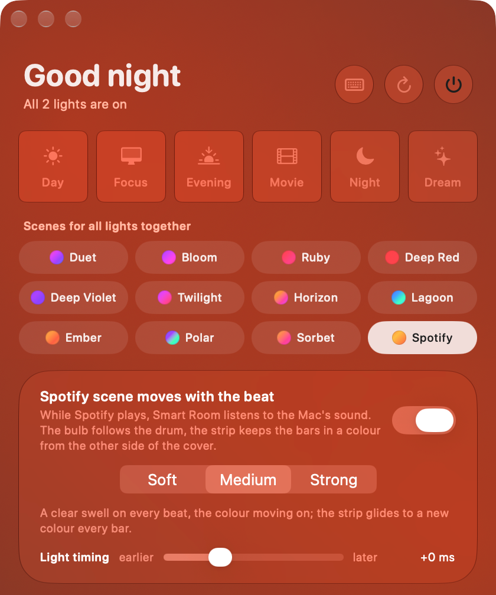

# smart-room

A macOS app that runs the lights of one room over the local network: WiZ bulbs and Yeelight strips, with presets, two-light colour scenes, keyboard control, and a Spotify scene that takes its colours from the album cover and moves with the beat.

The vendor apps each control one brand, live on the phone, and go through the cloud. This app sits in the menu bar of the Mac you are already working on, talks to the lamps directly (UDP for WiZ, TCP for Yeelight), and treats the room as one thing: one key press changes every light, and a scene gives each light its own part instead of the same colour twice.

No account, no cloud, no API key. Nothing leaves the local network except the download of the album cover from the address Spotify itself reports.



## What it does

- **Finds the lights by itself.** WiZ lamps answer a broadcast on UDP 38899, Yeelight lamps a search on UDP 1982. Addresses are never stored; a lamp that gets a new one from DHCP is found again.
- **Presets for the whole room.** Day, Focus, Evening, Movie, Night, Dream: brightness and colour temperature (or a flow) for every light at once.
- **Scenes for all lights together.** Eleven slow colour flows written for two lights, driven from one shared clock, so the lights drift apart, cross and meet again instead of mirroring each other.
- **Per-light control.** Brightness, white from warm to cool, colour, softness, flow speed, the lamp's built-in scenes (WiZ), blink to find out which lamp is which.
- **Keyboard from any app.** Global shortcuts, a number-pad mode toggled by the Clear key, and a Karabiner-Elements rule that puts the lights on F13–F19.
- **Menu bar.** Left click opens a compact panel, right click a menu with the presets and scenes.
- **On at sunset, off at sunrise.** Worked out on the Mac from its time zone; no location permission and no network.
- **Spotify scene.** The lights take four colours from the cover of the track playing in the Spotify desktop app, and, if you allow it, move with the beat of the music the Mac is playing.

## What is in the repo

| Path | Purpose |
|---|---|
| `Sources/SmartRoom/LightStore.swift` | The state of every light, the command queue, the flow clock, the beat show. |
| `Sources/SmartRoom/Light.swift` | Light model, colour maths, presets, flows and scenes. |
| `Sources/SmartRoom/WizTransport.swift`, `UDPSocket.swift` | WiZ local protocol: JSON datagrams on UDP 38899. |
| `Sources/SmartRoom/Yeelight.swift` | Yeelight LAN control: search on UDP 1982, JSON lines on TCP 55443, and a budget that keeps under the lamp's command quota. |
| `Sources/SmartRoom/Spotify.swift` | Asks the Spotify desktop app what is playing (AppleScript) and takes a palette from the cover. |
| `Sources/SmartRoom/Beat.swift` | System audio tap, kick and tempo detection, the Soft / Medium / Strong show styles. |
| `Sources/SmartRoom/SunSchedule.swift` | Sunrise and sunset from the system's time zone table. |
| `Sources/SmartRoom/RoomView.swift`, `CompactView.swift`, `Shortcuts.swift` | The window, the menu bar panel, the shortcuts sheet (SwiftUI). |
| `Sources/SmartRoom/KeyboardControl.swift`, `GlobalHotKeys.swift` | Global shortcuts and the number-pad mode (Carbon hot keys). |
| `Sources/SmartRoom/StatusItem.swift`, `MenuBarIcon.swift`, `DockPresence.swift` | Menu bar item and Dock behaviour. |
| `Resources/karabiner/smart-room.json` | Karabiner-Elements rule: F13–F19 and the Clear key. |
| `Resources/icon/` | Script and Swift source that draw the app icon. |
| `build.sh` | Builds the Swift package and wraps it into `build/Smart Room.app`. |

One Swift package, one executable target, about 4,500 lines, no dependencies outside the system frameworks.

## Quickstart

Built for macOS 26 or later (the package's minimum target) and tested on 27.2. Needs a Swift toolchain. The Xcode Command Line Tools are enough; Xcode itself is not required.

```sh
git clone https://github.com/Vladimir-Pirotskiy/smart-room.git
cd smart-room
./build.sh
open "build/Smart Room.app"
```

On the lamps:

- **WiZ**: the lamp has to be on the same network as the Mac. If it is not found, check that local communication is allowed in the WiZ app's settings.
- **Yeelight**: switch on **LAN Control** for the lamp in the Yeelight app.

macOS asks for up to three permissions, each the first time it is needed:

| Permission | Why | Without it |
|---|---|---|
| Local network | Finding and controlling the lamps. | Nothing works. |
| Automation → Spotify | Reading what is playing. | No Spotify scene. |
| System audio recording | Hearing the beat. Nothing is recorded or kept. | The Spotify scene glides through the cover's colours without reacting to the beat. |

The app is signed ad hoc, so macOS may ask for these again after a rebuild.

To check from a terminal that the lamps are reachable, without opening the window:

```sh
"build/Smart Room.app/Contents/MacOS/SmartRoom" --scan
```

## Keyboard

Global shortcuts, while the app is running:

| Keys | Action |
|---|---|
| ⌃⌥⌘ L | All lights on / off |
| ⌃⌥⌘ = and ⌃⌥⌘ − | Brighter / dimmer by 10% |
| ⌃⌥⌘ ] and ⌃⌥⌘ [ | Next / previous mood: the presets, then the scenes, round and round |
| ⌃⌥⌘ 1 … 6 | Day, Focus, Evening, Movie, Night, Dream |
| ⌃⌥⌘ 7, 8, 9 | Duet, Bloom, Ruby |
| ⌃⌥⌘ 0, or the Clear key | Number-pad mode: the pad controls the lights instead of typing digits |

A shortcut another app already owns is marked "shortcut taken by another app" in the app's menu.

For a keyboard with F13–F19, `Resources/karabiner/smart-room.json` is a Karabiner-Elements rule that maps those keys to the shortcuts above and makes the Clear key a dependable toggle for the number-pad mode. Copy it to `~/.config/karabiner/assets/complex_modifications/` and enable it in Karabiner-Elements → Complex Modifications.

## How it works

**Flows.** A flow is a list of hues and a time per hue. Each running flow has one clock; each light has a place on it. A WiZ lamp is stepped four times a second with unacknowledged `setPilot` datagrams. A Yeelight lamp accepts too few commands for that, so it gets a target every two seconds and does the gliding itself (`set_rgb … smooth 2000`). Colours are blended the short way round the hue wheel, so a move from violet to red goes through pink and not through grey.

**Spotify scene.** While a lit lamp is in the scene, the app asks the Spotify desktop app every two seconds for the player state and the cover address, and also listens for Spotify's playback notification. The cover is reduced to exactly four saturated hues that are at least 40° apart; a cover with no colour in it gives a warm amber palette. A new palette fades in over three seconds. Paused music stops the flow clock.

**Beat.** The Spotify Web API no longer gives audio analysis to newly registered apps, and neither Connect nor Jam carries rhythm, so the app listens instead: a Core Audio process tap on the Mac's output, mixed to mono.

- *Kicks*: energy below about 120 Hz in 10 ms hops, a fast average against a slow one.
- *Pulse*: autocorrelation of the last eight seconds of onsets, between 60 and 220 beats a minute, refined on four beats at once, held with hysteresis in both tempo and place in the bar so that syncopated music does not make the grid jump.
- *Timing*: each beat is announced 100 ms early, and the lights are delayed by the output device's own latency (the Bluetooth output it was tested with reports 160 ms), so that the light arrives with the sound and not with the samples. A slider covers what cannot be measured.
- *The show*: the bulb is the drum, swelling on every beat and falling back, its colour moving on. The strip keeps the bars: every bar or two it glides to a colour from the other side of the cover. Quiet passages make both smaller. Three styles, Soft, Medium and Strong, set the depth and speed.

The brightness the user chose is kept on disk while the show runs, and restored on quit and on the next launch, so a swell is never mistaken for a setting.

## Development

```sh
./build.sh                                              # release build and app bundle
swift build                                             # debug build of the executable
SMARTROOM_TRACE=1 "build/Smart Room.app/Contents/MacOS/SmartRoom"   # log every packet and beat to stderr
```

Command-line checks, all through the same code paths as the app:

| Command | Prints |
|---|---|
| `SmartRoom --scan [--preset day] [--dim 40]` | The lights found, optionally after applying a preset or a brightness. |
| `SmartRoom --sun` | Today's sunrise and sunset as the app works them out. |
| `SmartRoom --cover picture.jpg` | The four lamp colours the Spotify scene would take from that picture. |

The package builds with the Command Line Tools alone. That toolchain has no SwiftUI macro plug-ins, so views keep their state in `ObservableObject`s instead of view-local `@State`.

For exact sun times set the coordinates (degrees, north and east positive):

```sh
defaults write local.smartroom.app sunLatitude -float 52.52
defaults write local.smartroom.app sunLongitude -float 13.40
```

## Limitations

- **Tested on one room.** One WiZ colour bulb (module `ESP25_SHRGB_01`) and one Yeelight Lightstrip 1S (model `strip6`, firmware 20), on macOS 27.2 with Swift 6.4. Other WiZ and Yeelight colour lamps speak the same protocols and should work; none were tried. More than two lights at once was never tried either.
- **No automated tests.** Everything was checked by running it against the lamps and reading the packet trace.
- **The beat grid was checked in the logs, not on the lamps.** On the tracks it was run against, most detected kicks fell within one 10 ms hop of the grid. How long a lamp takes to show a command was not measured; that is what the timing slider is for.
- **A Yeelight strip cannot hit every beat.** It refuses more than 60 commands a minute per connection, so its part is one move per bar or two. Letting it play a long sequence by itself (`start_cf` with 24 steps of 60 ms) made the strip's control port drop every connection until its power was pulled; the app uses `start_cf` only for a two-step blink.
- **The beat is whatever the Mac is playing**, not Spotify alone: a notification sound or a video moves the lights too.
- **Spotify desktop app only.** The web player cannot be asked what is playing.
- **Sun times are approximate by default.** Without coordinates the app uses the reference city of the time zone, which can move sunrise and sunset by about twenty minutes.
- **Brightness is not balanced between hues.** A deep blue looks dimmer than an amber at the same setting.

Not affiliated with Spotify, WiZ, Signify or Yeelight.

## License

MIT, see `LICENSE`.
